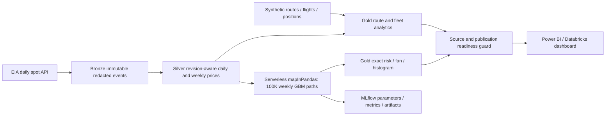

# Jet Fuel Hedge Risk Quantification Engine

I built this engine to measure how much fuel hedging reduces an airline's cost risk. It takes actual EIA fuel prices, stores them in revision-aware medallion tables, joins them with synthetic route analytics, runs 100,000 distributed GBM price paths, and publishes Power BI-ready hedge risk. Everything runs on **Databricks Free Edition**.

I reviewed the complete [PDD](pdd_airline_fuel_hedge_engine.docx) before writing code. Phases 1 to 5 are complete and audited. Phase 5 evidence and release status are tracked in docs/audits/phase-05.md, and the [release and handoff](docs/RELEASE.md) doc wraps it up. Good places to start are the [plan](docs/PLAN.md), the [handoff changelog](CHANGELOG.md), the [PDD corrections](docs/DECISIONS.md), the [audits](docs/audits) and the [runbook](docs/RUNBOOK.md). I filed each phase's findings on GitHub and resolved them before moving to the next phase.

## Architecture



The data lives in dedicated Unity Catalog schemas: `workspace.jet_fuel_bronze`, `workspace.jet_fuel_silver` and `workspace.jet_fuel_gold`. Deployment refuses to touch schemas that do not carry the project ownership marker. A managed volume holds captures, synthetic snapshots and the bounded stream checkpoint. Free Edition controls serverless resources, so I do not assume fixed workers or a paid cluster.

### Data and provenance

Prices are actual EIA Gulf Coast jet fuel, Cushing WTI, Brent and NY Harbor heating oil, captured from 2010 onward. The latest revision always wins, including withdrawals. Optional proxies stay null, and invalid records are quarantined. Crude prices are converted with USD/barrel ÷ 42 = USD/gallon. Daily 90-calendar-day volatility suppresses long return gaps, and weekly calibration rejects missing weeks. EIA echoes the API key back in responses, so I strip it before anything is stored or hashed.

Routes, flights, positions and brokers are **synthetic BTS-style fixtures**. They are not downloaded BTS data or a real airline portfolio. Eight routes have 8,395 scheduled and 8,198 operated flights, with 29,584,950 gallons in their trailing-year window. Historical costs compare hypothetical futures coverage with actual as-of prices. The separate risk reference carrier consumes **1.5 billion gallons/year**.

## Key results

The full distributed job `386315486361989` succeeded. Simulation `e35d376c-398b-4bea-8823-4f085f036fd9` has 100,000 unique paths, 500,000 scenario-cost rows and 53 fan steps. All five risk rows and every fan quantile reconcile independently with NumPy, and complete sample paths match. MLflow run `4c5cf414a2af4078a5ea0aa8c66186ef` is FINISHED. Simulation and tracking took **47.92 seconds**, not counting job startup. Later refresh runs are recorded in the changelog.

| Coverage | Mean $B | Absolute P95 $B | Incremental VaR95 $B | Absolute CVaR95 $B | VaR reduction |
| --- | ---: | ---: | ---: | ---: | ---: |
| 0% | 10.828 | 19.283 | 8.455 | 23.458 | 0% |
| 20% | 10.018 | 16.782 | 6.764 | 20.122 | 20% |
| 40% | 9.208 | 14.281 | 5.073 | 16.786 | 40% |
| 60% | 8.398 | 11.780 | 3.382 | 13.450 | 60% |
| 80% | 7.589 | 9.280 | 1.691 | 10.115 | 80% |


EWM annual arithmetic drift is 0.92914 and volatility is 0.60505, using 52 weekly returns from 2025-10-03 through 2026-10-02. The latest daily S0 is from 2026-10-06. High historical drift drives wide uncertainty and high simulated costs. This is an extrapolation, not a forecast of airline spending. The [exact results and provenance](dashboard/plots/provenance.json) are committed.

### Findings (refreshed measures, not fixed forecasts)

Phase 5 adds a five-page [Power BI Project](powerbi/JetFuelHedgeRisk/JetFuelHedgeRisk.pbip), [15 insight storyboards](dashboard/plots/insights) and an independent [verification workflow](docs/POWER_BI.md). The report recomputes its titles from guarded current facts. These findings describe verified live Gold data through **2026-10-20**, and the [verification evidence](docs/evidence/phase5_verification.json) records the source and run IDs. Routes and positions are synthetic, annual budget costs use the separate 1.5B-gallon reference carrier, and GBM is not a forecast.

- F1: crack expansion supplied 53.5% of the +$2.539/gal trailing-year jet move. The crack was about 4× its prior-years mean.
- F2: WTI's price-level correlation was 0.911, while its paired daily-return correlation was 0.375. Heating oil's was 0.897.
- F3: heating oil out-tracked WTI in 15 of 17 years. WTI reached weekly-return R²≥0.80 in only one year.
- F4: WTI-equivalent rose $1.180/gal versus jet's $2.539. Heating oil rose $2.742.
- F5: the forward beat spot in 41.6% of 824 windows. At 80% cover, historical P95 budget overrun fell from $1.22B to $0.34B, with +$0.08B/year mean cost.
- F6: the latest complete saving ranked at 98.5% of rolling windows. The fixture's unusually profitable year is not a typical-year expectation.
- F7: current drift ranked at 95.0% of all 824 valid calibrations. Only 772 have completed forward outcomes, and the supplied narrower benchmark gives different ranks and medians (DECISIONS #21).
- F8: EWM-drift bands covered 74.4% of realized purchase averages versus a nominal 90%, and 25.2% of high-drift outcomes fell below P05. Zero and risk-free drift covered about 84% and 83%.
- F9: three-sigma weekly moves happened 5.5× as often as a normal distribution implies. Excess kurtosis was 7.9.
- F10: 80% cover lowered model mean cost by $3.68B but raised historical mean cost by $0.08B. The model's gap between drift and carry drives its apparent saving.
- F11: simplified forward carry creates a 4.1% break-even price rise. An 80% hedge adds $1.89B under a −30% shock and saves $2.55B under +50%.
- F12: three daily B767 departures consumed 45.3% of the synthetic fixture's scheduled gallons.

The [publication and interpretation decisions](docs/DECISIONS.md) define inclusive return windows, missing-price and missing-week handling, full-sample ranks, overlapping-window dependence and nonadditive measures. Do not sum percentile, risk or correlation rows, and do not present the affine VaR reduction as an empirical discovery.

### The math

For weekly log returns $x_t$, normalize weights $w_t\propto0.94^{n-1-t}$. Estimate $m=\sum w_tx_t$, unbiased weighted variance $v=\sum w_t(x_t-m)^2/(1-\sum w_t^2)$, $\sigma=\sqrt{52v}$ and $\mu=52m+\sigma^2/2$.

With $\Delta t=1/52$, the exact transition is:

$$S_{t+\Delta t}=S_t\exp[(\mu-\sigma^2/2)\Delta t+\sigma\sqrt{\Delta t}Z].$$

Box-Muller generates the normals. PCG64 uses `SeedSequence(base_seed, path_id)`, so repartitioning cannot change a path. All hedge ratios share the same paths. Future weekly purchase averages exclude S0, and volume scales with the horizon.

With coverage $h$, simplified forward $F_0=S_0e^{rT}$ ($r=4\%$), and future weekly average $\bar S$, cost in billions is $GT[hF_0+(1-h)\bar S]/10^9$. P95 is the absolute 95th percentile, incremental VaR95 = P95 minus mean, and CVaR95 is the mean cost at or above absolute P95. SQL and NumPy use matching exact continuous quantiles.

**Coverage equals incremental VaR reduction by construction** in this affine common-path model, so it does not pick an optimal hedge. The sensitivity grid shows the opportunity cost when prices fall. I did not implement a commodity forward curve, convenience yield, basis risk, options valuation, margin or liquidity, or stochastic consumption. Position marks are linear spot proxies. Historical `hedge_pnl_usd = hedged - unhedged`, and `hedge_savings_usd` has the opposite sign. Long-futures position MTM is positive for gains.

## How to run it

You need Python 3.10+. Install with uv or pip as described in the runbook:

```powershell
uv sync --frozen --extra databricks --extra dev
# Copy .env.example to .env only if .env does not already exist; fill locally.
uv run fuel-hedge ingest --start 2010-01-01 --end 2026-10-09
uv run fuel-hedge silver
uv run python scripts/deploy_phase1.py --wait
uv run python scripts/verify_phase1.py
uv run python scripts/deploy_phase2.py
# Wait for the printed remote run to succeed before each verification/next phase.
uv run python scripts/verify_phase2.py
uv run python scripts/deploy_phase3.py
uv run python scripts/verify_phase3.py
uv run python scripts/verify_reporting.py
```

Use the latest completed day as the ingestion end date. Keep the workspace origin, token or OAuth, EIA key, warehouse ID and catalog in the ignored `.env` file. There is no fake-data fallback for historical prices. The [executed walkthrough](notebooks/walkthrough.ipynb) reproduces the pipeline, calibration and 100K paths locally, and `scripts/build_walkthrough.py` runs its four code cells. Production uses bounded serverless DataFrame batches and Delta tables.

### Tests

```powershell
uv run python -m unittest discover -s tests -v
uv run ruff check .
uv run python -m compileall -q src scripts notebooks
```

Forty tests cover revisions, units, calendars, integrity and replay, synthetic grains and marks, EWM, GBM moments, seed invariance, deterministic drift, horizons, historical alignment, starter DAX preservation and tails. Locked CI runs Python 3.10 and 3.12. The live verifiers check all Silver rows, all route costs, every insight cell, adversarial position inputs and the reporting guards. The actual refreshed Desktop DAX also reconciles headline and grain values.

### Reporting

[Databricks dashboard](https://<your-workspace>.cloud.databricks.com/dashboardsv3/<dashboard-id>). The definition and query checks pass. Browser rendering is still unverified, because the console restricts automated control. I inspected the exported chart above by eye.

Power BI hostname: `<your-workspace>.cloud.databricks.com`. HTTP path: `/sql/1.0/warehouses/<warehouse-id>`. Catalog `workspace`, schema `jet_fuel_gold`. Start with Import mode and the guarded `*_current` views. See the [connection and data contract](docs/POWER_BI.md), the [Power Query function](powerbi/GoldTable.pq) and the [DAX starter](powerbi/measures.dax). The PBIP/TMDL/PBIR report passed an actual Desktop Import, DAX reconciliation and inspection of all [five native pages](docs/evidence/powerbi/verification.json). Follow docs/POWER_BI.md for future refreshes.

### Scheduled refresh

The managed job runs these steps in order: recapture EIA, rebuild Silver, generate current-date synthetic fixtures, rebuild analytics, simulate risk, and publish the reporting guards. One concurrent run, bounded timeouts, and source and run lineage protect what gets published. Free Edition quotas may interrupt compute, so check readiness before an Import refresh. Missing rows mean the publication is stale or incomplete, not that risk is zero. A [five-minute demo script](docs/DEMO.md) is ready. Recording and uploading the Loom video needs my own recorder and account.

## Project structure

- `src/`: the `fuel-hedge` package (ingestion, Silver, analytics, simulation)
- `scripts/`: deploy and verify scripts for each phase, plus `build_walkthrough.py`
- `sql/`: eight numbered SQL steps (route burn, price correlation, hedge MTM, risk metrics, hedge sensitivity, fleet summary, reporting contract, insights)
- `data/fixtures/`: synthetic fixture data
- `tests/`: the unit test suite
- `notebooks/walkthrough.ipynb`: executed local walkthrough
- `dashboard/plots/`: exported risk chart, provenance JSON and insight storyboards
- `powerbi/`: the Power BI Project, Power Query function and DAX starter measures
- `docs/`: plan, runbook, decisions, audits, evidence, Power BI guide, demo script and release notes

## What I learned and what broke

- Fuel prices get revised. I had to make Silver revision-aware so the latest revision (including withdrawals) wins, instead of trusting the first value I captured.
- The EIA API echoes the API key back in its responses. I now strip it before anything is persisted or hashed.
- Spot price levels can mislead. WTI's price-level correlation with jet fuel was 0.911, but its daily-return correlation was only 0.375. That is why heating oil is the better proxy (it out-tracked WTI in 15 of 17 years).
- Fuel price moves have fat tails. Three-sigma weekly moves happened 5.5× more often than a normal distribution predicts, and the EWM-drift bands covered only 74.4% of outcomes versus a nominal 90%. GBM is a useful baseline, not a forecast.
- In this model, coverage equals VaR reduction by construction. I learned to say that plainly instead of presenting it as a discovery.
- Not everything could be automated. Browser rendering of the Databricks dashboard is still unverified because the console blocks automated control.

Sources: [EIA](https://www.eia.gov/opendata/), [Free Edition limits](https://docs.databricks.com/aws/en/getting-started/free-edition-limitations), [serverless limits](https://docs.databricks.com/aws/en/compute/serverless/limitations), [Microsoft connector](https://learn.microsoft.com/en-us/power-query/connectors/databricks). Assumptions and PDD corrections are in the decision log.
