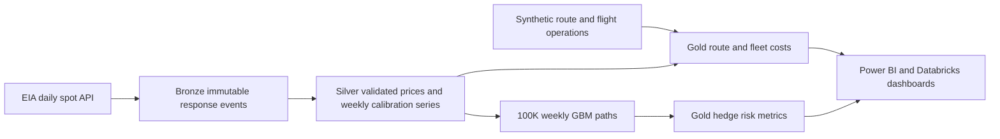

# Jet Fuel Hedge Risk Quantification Engine

An airline treasury analytics project that turns EIA historical prices into a Databricks Free Edition medallion pipeline, route/fleet cost analysis, and simulated fuel hedge risk. The reference scenario uses 1.5 billion gallons per year and five futures hedge ratios; operational fixtures will be explicitly synthetic.

Implementation is progressing through audited phases. **Phase 1 is in live verification; Gold and simulation outputs are not ready yet.** See [the implementation plan](docs/PLAN.md), [handoff changelog](CHANGELOG.md), [PDD decisions](docs/DECISIONS.md), and [runbook](docs/RUNBOOK.md). The source specification is [the PDD](pdd_airline_fuel_hedge_engine.docx).



Use a local Git-ignored `.env` for credentials. Never paste tokens into source, notebooks or issues. Free Edition uses serverless DataFrame APIs, dedicated project schemas and Unity Catalog volumes.

```powershell
uv sync --frozen --extra databricks --extra dev
uv run fuel-hedge ingest --start 2010-01-01 --end 2026-10-09
uv run fuel-hedge silver
uv run python scripts/deploy_phase1.py --wait
uv run python scripts/verify_phase1.py
```

Update the end date to the latest completed business day. The daily pipeline publishes to `workspace.jet_fuel_bronze` and `workspace.jet_fuel_silver`; the reporting schema is `workspace.jet_fuel_gold`. Actual deployment evidence and phase audit issues are tracked in the changelog.
