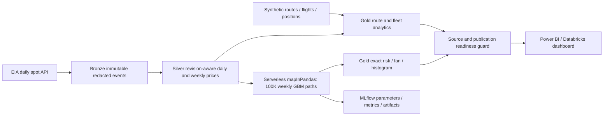
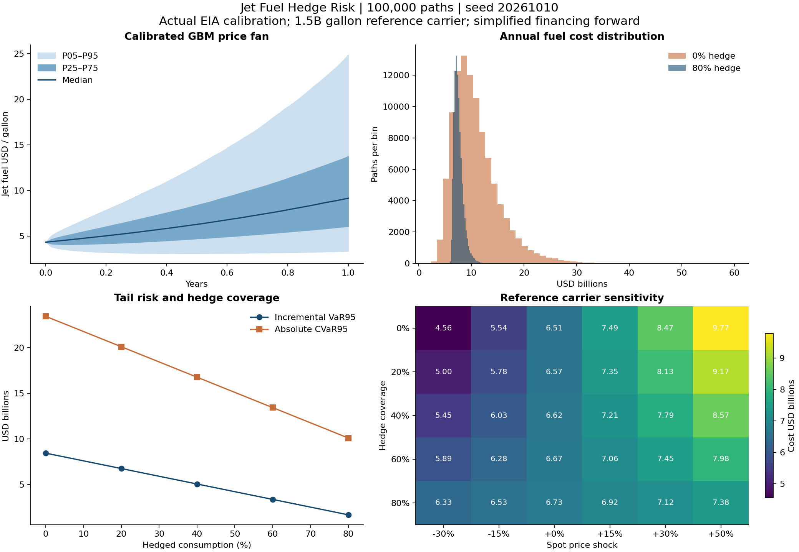

# Jet Fuel Hedge Risk Quantification Engine

Actual EIA prices → revision-aware medallion data → synthetic route analytics → 100,000 distributed GBM paths → Power BI-ready hedge risk on **Databricks Free Edition**.

The complete [PDD](pdd_airline_fuel_hedge_engine.docx) was reviewed before implementation. Phases 1–4 are complete and audited; Phase 5 evidence and release status are tracked separately in docs/audits/phase-05.md; see the [release and handoff](docs/RELEASE.md). Start with the [plan](docs/PLAN.md), [handoff changelog](CHANGELOG.md), [PDD corrections](docs/DECISIONS.md), [audits](docs/audits) and [runbook](docs/RUNBOOK.md). Phase findings are filed on GitHub and resolved before advancing.

## Architecture and provenance



Dedicated Unity Catalog schemas: `workspace.jet_fuel_bronze`, `workspace.jet_fuel_silver`, `workspace.jet_fuel_gold`. Deployment refuses schemas without the project ownership marker. A managed volume holds captures, synthetic snapshots and the bounded stream checkpoint. Free Edition controls serverless resources; no fixed-worker or paid-cluster assumption is made.

Prices are actual EIA Gulf Coast jet fuel, Cushing WTI, Brent and NY Harbor heating oil, captured from 2010 onward. Latest revisions—including withdrawals—win; optional proxies stay null. Invalid records are quarantined. Crude USD/barrel ÷ 42 = USD/gallon. Daily 90-calendar-day volatility suppresses long return gaps; weekly calibration rejects missing weeks. EIA's echoed API key is stripped before persistence/hashing.

Routes, flights, positions and brokers are **synthetic BTS-style fixtures**, not downloaded BTS data or a real airline portfolio. Eight routes have 8,395 scheduled / 8,198 operated flights and 29,584,950 gallons in their trailing-year window. Historical costs compare hypothetical futures coverage with actual as-of prices. The separate risk reference carrier consumes **1.5 billion gallons/year**.

## Verified results

Full distributed job `386315486361989` succeeded. Simulation `e35d376c-398b-4bea-8823-4f085f036fd9` has 100,000 unique paths, 500,000 scenario-cost rows and 53 fan steps. All five risk rows and every fan quantile reconcile independently with NumPy; complete sample paths match. MLflow `4c5cf414a2af4078a5ea0aa8c66186ef` is FINISHED. Simulation/tracking work: **47.92 seconds**, excluding job startup. Subsequent refresh runs are recorded in the changelog.

| Coverage | Mean $B | Absolute P95 $B | Incremental VaR95 $B | Absolute CVaR95 $B | VaR reduction |
| --- | ---: | ---: | ---: | ---: | ---: |
| 0% | 10.828 | 19.283 | 8.455 | 23.458 | 0% |
| 20% | 10.018 | 16.782 | 6.764 | 20.122 | 20% |
| 40% | 9.208 | 14.281 | 5.073 | 16.786 | 40% |
| 60% | 8.398 | 11.780 | 3.382 | 13.450 | 60% |
| 80% | 7.589 | 9.280 | 1.691 | 10.115 | 80% |



EWM annual arithmetic drift is 0.92914 and volatility 0.60505, using 52 weekly returns from 2025-10-03 through 2026-10-02. Latest daily S0 is from 2026-10-06. High historical drift drives broad uncertainty and high simulated costs; this extrapolation is not a forecast of airline spending. [Exact results/provenance](dashboard/plots/provenance.json) are committed.

## What we learned — refreshed measures, not fixed forecasts

Phase 5 supplies a five-page [Power BI Project](powerbi/JetFuelHedgeRisk/JetFuelHedgeRisk.pbip), [15 insight storyboards](dashboard/plots/insights) and an independent [verification workflow](docs/POWER_BI.md). The report recomputes its titles from guarded current facts. The following findings describe the 2026-10-06 development extract; current live verification and source/run IDs supersede these numbers after refresh. Routes and positions are synthetic; annual budget costs use a separate 1.5B-gallon reference carrier. GBM is not a forecast.

- F1: crack expansion supplied 63.9% of the +$2.224/gal trailing-year jet move; the crack was about 4× its prior-years mean.
- F2: WTI's price-level correlation was 0.941, while paired daily-return correlation was 0.496; heating oil's was 0.912.
- F3: heating oil out-tracked WTI in 15 of 17 years; WTI reached weekly-return R²≥0.80 in one year.
- F4: WTI-equivalent rose $0.804/gal versus jet's $2.224; heating oil rose $2.348.
- F5: the forward beat spot in 41.5% of 822 windows. At 80% cover, historical P95 budget overrun fell $1.21B→$0.34B, with +$0.09B/year mean cost.
- F6: the latest complete saving ranked at 98.3% of rolling windows; the fixture's unusually profitable year is not a typical-year expectation.
- F7: current drift ranked at 94.3% of all 822 valid calibrations. Only 770 have completed forward outcomes; the supplied narrower benchmark gives different ranks/medians (DECISIONS #21).
- F8: EWM-drift bands covered 74.5% of realized purchase averages versus nominal 90%; 25.2% of high-drift outcomes fell below P05. Zero/risk-free drift covered about 84%/83%.
- F9: three-sigma weekly moves occurred 5.5× the normal-implied rate; excess kurtosis was 7.9.
- F10: 80% cover lowered model mean cost $3.24B but raised historical mean cost $0.09B. The model's drift–carry gap drives its apparent saving.
- F11: simplified forward carry creates a 4.1% break-even price rise; an 80% hedge adds $1.78B under a −30% shock and saves $2.39B under +50%.
- F12: three daily B767 departures consumed 45.3% of the synthetic fixture's scheduled gallons.

[Publication and interpretation decisions](docs/DECISIONS.md) define inclusive return windows, missing-price/week handling, full-sample ranks, overlapping-window dependence and nonadditive measures. Do not sum percentile/risk/correlation rows or present affine VaR reduction as an empirical discovery.

## Mathematics and interpretation

For weekly log returns $x_t$, normalize weights $w_t\propto0.94^{n-1-t}$. Estimate $m=\sum w_tx_t$, unbiased weighted variance $v=\sum w_t(x_t-m)^2/(1-\sum w_t^2)$, $\sigma=\sqrt{52v}$ and $\mu=52m+\sigma^2/2$.

With $\Delta t=1/52$, the exact transition is:

$$S_{t+\Delta t}=S_t\exp[(\mu-\sigma^2/2)\Delta t+\sigma\sqrt{\Delta t}Z].$$

Box–Muller generates normals. PCG64 uses `SeedSequence(base_seed, path_id)` so repartitioning cannot alter a path. All hedge ratios share paths. Future weekly purchase averages exclude S0; volume scales by horizon.

With coverage $h$, simplified forward $F_0=S_0e^{rT}$ ($r=4\%$), and future weekly average $\bar S$, cost in billions is $GT[hF_0+(1-h)\bar S]/10^9$. P95 is the absolute 95th percentile; incremental VaR95 = P95 − mean; CVaR95 is mean cost at/above absolute P95. SQL and NumPy use matching exact continuous quantiles.

**Coverage equals incremental VaR reduction by construction** in this affine common-path model; it does not determine an optimal hedge. The sensitivity grid exposes opportunity costs when prices fall. No commodity forward curve, convenience yield, basis risk, options valuation, margin/liquidity or stochastic consumption is implemented. Position marks are linear spot proxies. Historical `hedge_pnl_usd = hedged − unhedged`; `hedge_savings_usd` has opposite sign. Long-futures position MTM is positive for gains.

## Reproduce and deploy

Python 3.10+; use uv or pip installation per the runbook:

```powershell
uv sync --frozen --extra databricks --extra dev
# Copy .env.example to .env only if .env does not already exist; fill locally.
uv run fuel-hedge ingest --start 2010-01-01 --end 2026-10-09
uv run fuel-hedge silver
uv run python scripts/deploy_phase1.py --wait
uv run python scripts/verify_phase1.py
uv run python scripts/deploy_phase2.py
# Wait for the printed remote run to succeed before each verification/next phase.
uv run python scripts/verify_phase2.py
uv run python scripts/deploy_phase3.py
uv run python scripts/verify_phase3.py
uv run python scripts/verify_reporting.py
```

Use the latest completed day as ingestion end date. Store workspace origin, token/OAuth, EIA key, warehouse ID and catalog in ignored `.env`. No fabricated-data fallback replaces historical prices. The [executed walkthrough](notebooks/walkthrough.ipynb) reproduces the pipeline/calibration/100K paths locally; `scripts/build_walkthrough.py` executes its four code cells. Production uses bounded serverless DataFrame batches and Delta tables.

```powershell
uv run python -m unittest discover -s tests -v
uv run ruff check .
uv run python -m compileall -q src scripts notebooks
```

Twenty-nine tests cover revisions, units, calendars, integrity/replay, synthetic grains/marks, EWM, GBM moments, seed invariance, deterministic drift, horizons and tails. Locked CI runs Python 3.10/3.12. Live verifiers check all Silver rows, all route costs, adversarial position inputs and reporting guards.

## Reporting and operation

[Databricks dashboard](https://dbc-236f6036-39b4.cloud.databricks.com/dashboardsv3/01f1c50e22881d6ea243de94f87b3f46). Definition/query checks pass; browser rendering remains unverified because the console restricts automated control. The exported chart above was visually inspected.

Power BI hostname: `dbc-236f6036-39b4.cloud.databricks.com`; HTTP path: `/sql/1.0/warehouses/e4f1304cb2d303ea`; catalog `workspace`; schema `jet_fuel_gold`. Start with Import and guarded `*_current` views. See [connection/data contract](docs/POWER_BI.md), [Power Query function](powerbi/GoldTable.pq) and [DAX starter](powerbi/measures.dax). A PBIP/TMDL/PBIR report is now supplied; native authentication, refresh, DAX execution and page screenshots follow the explicit checklist in docs/POWER_BI.md.

The managed job recaptures EIA, rebuilds Silver, generates current-date synthetic fixtures, rebuilds analytics, simulates risk and publishes reporting guards sequentially. One concurrent run, bounded timeouts and source/run lineage protect publication. Free Edition quotas may interrupt compute. Require readiness before Import refresh; unavailable rows mean stale/incomplete publication, not zero risk. [Five-minute demo script](docs/DEMO.md) is ready; Loom recording/upload requires the user's recorder/account.

Sources: [EIA](https://www.eia.gov/opendata/), [Free Edition limits](https://docs.databricks.com/aws/en/getting-started/free-edition-limitations), [serverless limits](https://docs.databricks.com/aws/en/compute/serverless/limitations), [Microsoft connector](https://learn.microsoft.com/en-us/power-query/connectors/databricks). Assumptions and PDD corrections are in the decision log.
